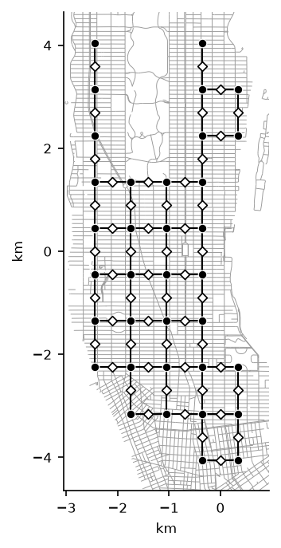
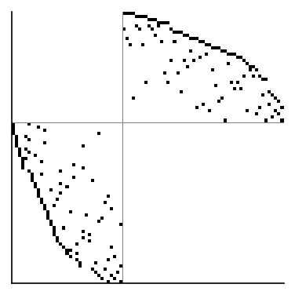
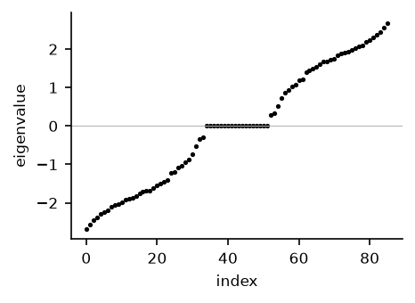
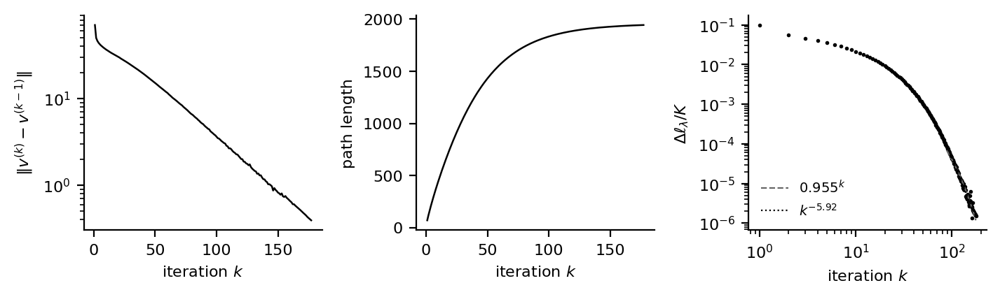
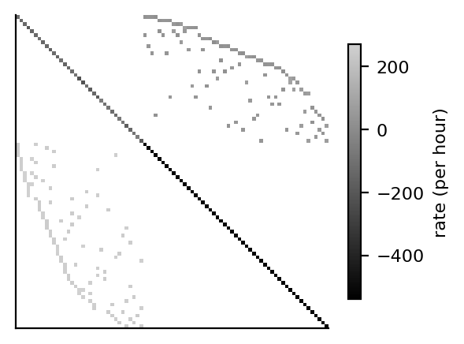
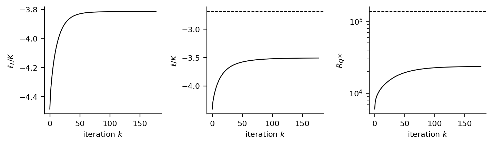
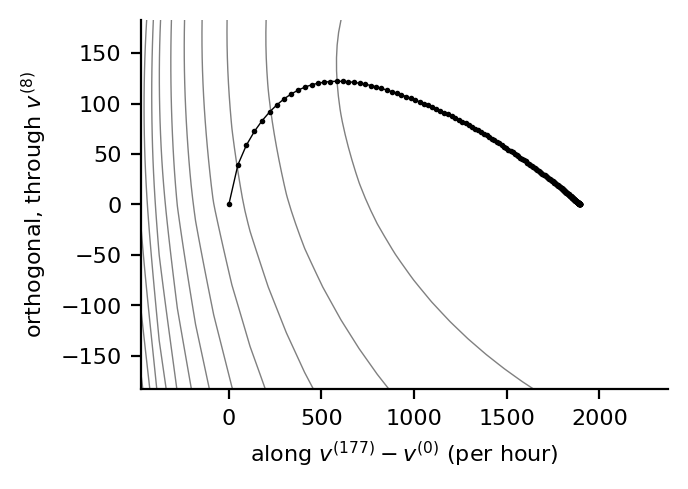

# Penalized EM from endpoint-only taxi trips

Code and results for the NYC example in the paper

> D. Bose and B. G. Bodmann, *Iterative regularized likelihood maximization for
> continuous-time Markov processes with endpoint-only observations* (in preparation).

The paper estimates the generator $Q$ of a continuous-time Markov chain when each
trajectory is observed only at its start and end. The endpoint likelihood need not
attain its supremum, so a penalty $\lambda R_Q$ is subtracted, where $R_Q$ is a
weighted $\ell^1$ norm of the coefficients of $Q$ in a Parseval frame built from the
Dirac operator of the graph. The penalized endpoint log-likelihood
$\ell_\lambda = \ell - \lambda R_Q$ is maximized by an expectation–maximization (EM)
recursion. This folder runs that recursion on the yellow-cab trips in the repository
root and checks its convergence.

## Setup

| | |
|---|---|
| Trips | the 64,999-record extract `../yellow_tripdata_2016-01.csv` (January 2016) |
| Zones | coordinates rotated by 29° so that the avenues run vertically, grouped into 0.7 × 0.9 km cells; the 35 cells with the most pickups and drop-offs are the zones |
| Links | one link state for each pair of zones whose cells share a side: 51 links |
| State space | 35 zones + 51 links = 86 states; the 204 allowed jumps are zone → incident link and link → its two zones |
| Observations | trips that start and end in these zones and last 1 to 90 minutes: $K = 31{,}498$; durations grouped into 16 quantile bins (2.1 to 25.6 minutes) |
| Penalty | $\lambda = 0.413$, floor $\varepsilon = 0.01$ on every allowed rate |
| Start | the uniform generator: rate $c = 74.79$ per hour on all 204 allowed jumps |

Each iteration has two steps.

* **E-step.** The expected number of jumps along each allowed transition and the expected
  time in each state, given the observed endpoints, from the forward–backward
  factorization. They are computed with Van Loan's block matrix exponential: one
  172 × 172 exponential per duration bin, so 16 per iteration.
* **M-step.** Maximize the expected complete-data log-likelihood minus $\lambda R_Q$, a
  strictly concave problem, with Clarabel through CVXPY (gap and feasibility tolerances
  $10^{-10}$). A solution is accepted only if it does not decrease this objective;
  otherwise the default Clarabel settings and then SCS are tried, and the current
  iterate is kept if none succeeds.

All rates are per hour.

This is not the same graph as the analysis in the repository root, which uses the 30
busiest TLC zones and a Doob-bridge refinement. Here the zones are grid cells, links are
states of the chain, and there is no bridge step.

## Running it

```bash
cd penalized_em_endpoints
pip install -r requirements.txt

python3 run_uniform.py           # the EM run (saved after every iteration in runs/)
python3 convergence_report.py    # report.txt and figures 04-07 in output_c74.79/
python3 state_space_figures.py   # figures 01-03 in figures/
```

`runs/uniform_c74.79.npz` holds the run reported below, so `run_uniform.py` only says
that this run has already stopped. To recompute it from the uniform start, delete that
file first; one iteration takes about 20 seconds on a laptop. The run stops by itself
when the relative step falls below $10^{-6}$ (`--tol`), when the M-step can no longer
improve the objective, or after 2000 iterations (`--max-iters`). Ctrl-C and the same
command again continue from the last saved iteration. Other options: `--c` (initial
rate), `--lam` (penalty weight); `python3 convergence_report.py --no-contour` skips the
contour figure.

## Results

The M-step could not improve the objective at iteration 178, so the run stopped there,
and the report uses iterations 0 to 177. The full numbers are in
[`output_c74.79/report.txt`](output_c74.79/report.txt).

| Quantity | Value |
|---|---|
| $\ell_\lambda/K$ (penalized log-likelihood per trip) | −4.4848 → −3.8145, never decreasing; 90% of the gain after 29 iterations |
| $\ell/K$ (endpoint log-likelihood per trip) | −4.4063 → −3.5063 |
| $R_Q$ | 5,981 → 23,504; at the end $\lambda R_Q/K = 0.31$ |
| Step $\lVert v^{(k)}-v^{(k-1)}\rVert$ at $k$ = 1, 50, 100, 150, 177 | 70.2, 15.1, 3.62, 0.82, 0.39 |
| Step ratio per iteration, windows of 25 iterations from $k\approx50$ | between 0.970 and 0.973 |
| Remaining path if this ratio persists | about 13, i.e. 0.5% of $\lVert v^{(177)}\rVert = 2660$ |
| Path length / distance from start to end | 1944 / 1896 |
| Increments of $\ell_\lambda$ on $k \ge 88$ | fitted by $0.955^k$ (rms residual 0.181) and by $k^{-5.92}$ (0.145) |
| Smallest rate over all iterates | 11.52 per hour, against the floor 0.01 |
| Zone → link rates of $Q^{(177)}$ | 11.5 to 96.0 per hour |
| Link → zone rates of $Q^{(177)}$ | 248.4 to 271.1 per hour |
| Mean holding time | 0.28 to 1.17 minutes in a zone, 0.11 to 0.12 minutes in a link |

$v^{(k)}$ is the vector of the 204 allowed rates of the $k$-th iterate. A constant step
ratio is what geometric convergence looks like. With a Łojasiewicz exponent
$\theta \le 1/2$ at the limit, the convergence theory predicts geometric decay. Because
the smallest rate stays more than a thousand times above the floor, the floor is never
active.

## Figures

<table>
  <tr>
    <td><br><sub>Zones (discs) and links (diamonds) on the street map</sub></td>
    <td><br><sub>Nonzero entries of the Dirac operator, zones first</sub></td>
    <td><br><sub>Spectrum of the Dirac operator; 18 zero eigenvalues</sub></td>
  </tr>
  <tr>
    <td colspan="3"><br><sub>Step length (log axis), cumulative path length, and increments of the penalized log-likelihood with geometric and power-law fits</sub></td>
  </tr>
  <tr>
    <td><br><sub>The estimate Q<sup>(177)</sup>; zones first, blank = not allowed, diagonal = minus the exit rates</sub></td>
    <td><br><sub>Penalized log-likelihood, log-likelihood and R<sub>Q</sub> against the iteration, with the bounds of the theory (dashed)</sub></td>
    <td><br><sub>Penalized log-likelihood on the plane through the start, iterate 8 and the end; dots are the iterates</sub></td>
  </tr>
</table>

## Files

```
run_uniform.py                  EM from the uniform generator, resumable
convergence_report.py           convergence report and figures 04-07
state_space_figures.py          figures 01-03
em_tools.py                     EM loop with checkpoints, stopping rule, diagnostics
run_taxi.py                     data preparation, zones and links, Dirac operator, lambda
bridge_em.py                    E-step, M-step, regularizer, likelihoods
em_run_v2.npz                   the companion-paper estimator Q* and an earlier run from it
manhattan_streets.npz           Manhattan street centerline (for figure 01) + provenance .json
runs/uniform_c74.79.npz         all iterates of the run reported above
output_c74.79/                  report.txt and figures 04-07
figures/                        figures 01-03
```

## Notes

* **Where $\lambda$ and $c$ come from.** The values were taken from the companion-paper
  estimator $Q^\star$ in `em_run_v2.npz`. $\lambda = 0.413$ is $0.1\lambda^\star$, where
  $\lambda^\star = 4.131$ is the multiplier of that estimator. $c = 74.79$ gives the
  uniform generator the same $R_Q$ as $Q^\star$. Both can be changed with `--lam` and
  `--c`; the convergence results hold for every $\lambda > 0$.
* **Unused code.** `bridge_em.py` also contains Doob-bridge and skeleton functions from
  an earlier version of the project; they are not used here.
* **Reproducibility.** Different versions of CVXPY and Clarabel can change the last
  digits of the iterates. The stall at iteration 178 is a limit of the solver accuracy,
  not of the method.
* **Data.** The street geometry is the NYC Street Centerline (CSCL), obtained through the
  R package [nycstreets](https://github.com/kjhealy/nycstreets); see
  `manhattan_streets_provenance.json`.
